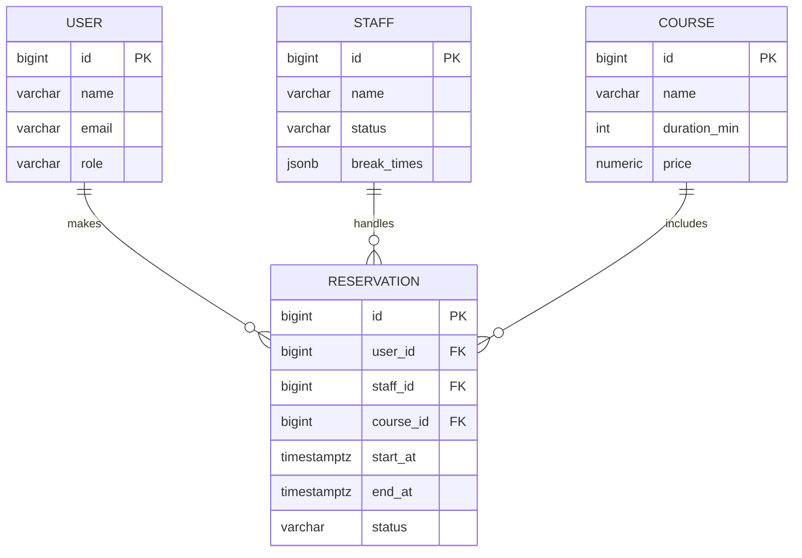

# 予約管理システム 要件定義

## 1. 概要
- **目的**: PC ブラウザで予約受付と店舗管理を行うシステムを構築する  
- **利用者**: お客さま／店舗スタッフ／店舗管理者  
- **対応環境**: PC ブラウザ（スマホ対応は将来対応予定）

## 2. 前提・ルール
- コースは固定で **30 / 60 / 90 分**
- 予約タイプは **「フリー」** または **「担当者指定」**  
  - フリー予約メールには担当者名を入れない  
  - 担当者指定予約メールには担当者名を明記
- 重複予約は **UI 非活性**＋**DB ユニーク制約**で防止  
  - 競合発生時は **先着優先**、後勝ちは即時キャンセル  
  - キャンセル通知文面（固定）  
    > 先に予約が入りましたのでキャンセルとさせていただきます

## 3. 機能要件

### 3.1 予約フロー（お客さま）
1. **担当者／コース選択（統合画面）**  
   - 担当者（「フリー」または担当者A/B/C…）をプルダウンで選択
   - コース（30/60/90分）をプルダウンで選択
   - 「日時を選択へ進む」ボタンで次画面へ
2. **カレンダーで空き枠選択**（空きのみクリック可）  
   - 3日分（当日・翌日・翌々日）を横並びで表示
   - 10:00〜24:00まで30分刻みの枠を行として表示
   - 空き枠は「選択」ボタン、予約不可枠は「予約不可」ボタン（グレーアウト）
   - 翌々日枠は「時間までお待ちください」画面へ遷移
3. **入力確認**  
   - 選択内容（担当者/フリー、コース、日時）を表示
   - フリーの場合「担当者: フリー」、担当者指定時は担当者名を表示
4. **完了画面** & **確認メール送信**  
   - 予約完了メッセージとトップへの戻るボタン

### 3.2 確認メール
- 〇〇様
- 以下の内容で予約を承りました。
- ■日付: YYYY/MM/DD
- ■時間: HH:MM（コース NN 分）
- 【フリーの場合: 担当者: フリー】
- 【担当者指定の場合のみ表示 → 担当者: △△】

### 3.3 店舗ダッシュボード
- **週次カレンダー**  
- プルダウンで〈全員〉または担当者 A/B/C… を切替  
- 1 マス = 30 分、予約は色付きバー、休憩は灰色
- **担当者設定**: 追加・削除・退職フラグ
- **コース設定**: 時間・料金・説明文の変更

### 3.4 API / 排他制御
| API | 概要 | 排他制御 |
| --- | --- | --- |
| `POST /reservations` | 予約作成 | `(staff_id, start_at)` にユニーク制約 |
| `GET /reservations` | 予約一覧取得 | ― |
| `DELETE /reservations/{id}` | 予約取消 | ― |

- 競合時レスポンス: **HTTP 409 Conflict**  
- フロント表示: 「申込中に他のお客様が確定しました」

## 4. 非機能要件
| 項目 | 要件 |
| --- | --- |
| パフォーマンス | 週次カレンダー描画 < **1.5 秒** |
| 可用性 | **99.9 % / 月** |
| セキュリティ | **TLS1.2+**、CSRF 対策、管理画面 2FA |
| 拡張性 | **REST / GraphQL API** で将来のスマホ・ネイティブ対応可 |
| ロギング | 予約・ユーザー操作を監査ログ **7 年保管** |

## 5. データモデル（簡易）


## 6. 画面遷移・実装済みフロー

```
トップ（担当者・コース選択）
 └─ カレンダー選択
      ├─ 翌々日選択時：時間までお待ちください画面
      └─ 入力確認
           └─ 完了
```

### 実装済みUIの主な仕様
- 画面はReact + MUIで実装
- 担当者・コースはプルダウンで同一画面選択
- 選択内容は画面遷移時にstateで受け渡し
- カレンダーは3日分・30分刻み・10:00〜24:00表示
- 翌々日枠は「時間までお待ちください」画面へ遷移
- 各画面で選択肢・確認内容を明示的に表示
- 完了画面でトップに戻るボタンあり

---
